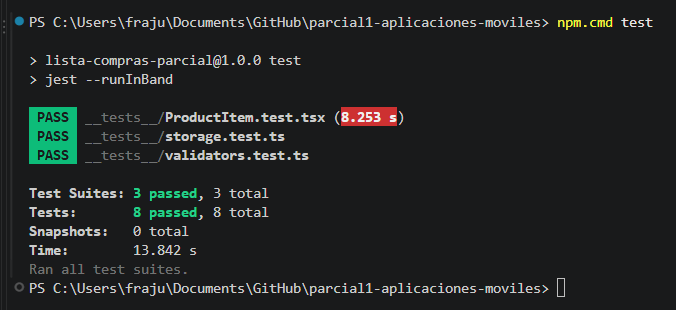

# Mi lista de compras — Parciales 1 y 2 de Aplicaciones Móviles

**Alumno:** Franco Julián Barrera · **Opción elegida:** Lista de compras inteligente.

Aplicación con React Native, Expo SDK 58 y TypeScript. Continúa el proyecto del primer parcial e incorpora Zustand y acceso a recursos del dispositivo: fotos, ubicación del comercio, contactos y calendario.

[Repositorio del proyecto](https://github.com/FrancoJulianB/parcial1-aplicaciones-moviles).

## Ejecución

Requiere Node.js 22.13 o posterior de la rama 22, 24.3 o posterior de la rama 24, o 26 o posterior, y Expo Go compatible con SDK 58. La integración de calendario tiene el [requisito adicional indicado más abajo](#calendario).

```bash
npm install
npm start
```

Con el teléfono y la computadora en la misma red, escanear el QR desde la cámara de iOS o desde Expo Go en Android. Si la red local no está disponible:

```bash
npx expo start --tunnel
```

Expo puede solicitar instalar el paquete del túnel o iniciar sesión.

## Funcionalidades conservadas del primer parcial

- Registro local con usuario, contraseña, confirmación y control de duplicados.
- Login y navegación privada; cierre de sesión. Al reiniciar se solicita un nuevo login.
- Alta de productos con nombre y cantidad, listado, marcado como comprado y eliminación con confirmación.
- Listas independientes por usuario, persistidas con AsyncStorage.
- Recordatorio local con expo-notifications a los diez segundos. Modificar la lista o cerrar sesión cancela el recordatorio pendiente.
- Validaciones, mensajes de error y componentes reutilizables con estilos de React Native.

La autenticación es didáctica y local: las contraseñas se guardan sin cifrar. No utiliza backend ni bases de datos externas. Las notificaciones requieren un teléfono con permisos habilitados.

## Ampliaciones del segundo parcial

Las pantallas originales —Login, Registro, Home y Alta— se conservan y se agrega el detalle del producto. Fotos, ubicación y contactos son opcionales y se pueden asociar desde el alta o el detalle.

### Estado global con Zustand

El Context original se reemplazó por `src/store/useAppStore.ts`. El store administra usuario autenticado, productos y estado de operación, con acciones de alta, actualización, eliminación y acceso a los recursos del dispositivo. Las pantallas consumen datos y acciones mediante selectores individuales.

Los campos y errores de formularios siguen como estado local. Los cambios de productos se guardan antes de actualizar la interfaz. La sesión no se persiste.

Se mantienen las claves de AsyncStorage: `@compras:usuarios` y `@compras:productos:<usuario normalizado>`. Los nuevos campos son opcionales, por lo que los productos del primer parcial siguen siendo compatibles. No se utiliza el middleware persist de Zustand.

### Permisos

Los permisos se consultan y solicitan al utilizar cada recurso, con estados de espera, acceso concedido y denegado. Se muestran mensajes ante rechazos o errores y acceso a Ajustes cuando el permiso está bloqueado. Contactos también contempla acceso limitado en iOS. En Expo Go, los permisos se administran para Expo Go en los ajustes del teléfono; para calendario, consultar su [limitación específica](#calendario).

### Cámara y galería

Con expo-image-picker se puede tomar una foto o elegirla desde la galería, ver una vista previa, reemplazarla o quitarla. Cancelar el selector conserva la imagen anterior. Si se rechaza la cámara, sigue disponible la galería.

La foto se muestra como miniatura en la lista y en el detalle. Tocar el nombre o la miniatura abre el detalle; marcar como comprado y eliminar tienen controles independientes.

expo-file-system copia la imagen a la carpeta de documentos de la app. AsyncStorage guarda su nombre relativo y la URI se reconstruye al mostrarla, sin depender solo de la caché. Si falla el guardado, se conservan los datos anteriores y se intenta limpiar la copia nueva. La persistencia local no protege frente a la desinstalación.

### Ubicación del comercio

expo-location obtiene la ubicación actual al tocar Usar ubicación actual. Se guardan y muestran las coordenadas GPS; se pueden actualizar o quitar. Solo se solicita ubicación en primer plano.

También se puede escribir un nombre o dirección y tocar Usar comercio manual. Se distingue del dato obtenido por GPS y lo reemplaza si existía. Ante permiso denegado o localización no disponible se permite reintentar o usar esta alternativa. No se utilizan mapas, servicios externos ni claves API.

### Contacto relacionado

expo-contacts permite elegir un contacto del teléfono con búsqueda por nombre, teléfono o email. Con acceso limitado en iOS solo se muestran los contactos autorizados.

Se guarda el nombre y, cuando existen, el primer teléfono y email disponibles. La agenda permanece temporalmente en el selector y no se persiste. El contacto asociado es una copia de esos datos; no modifica la agenda del teléfono.

Se puede reemplazar o quitar el contacto. Cancelar conserva el anterior. Si se deniega el permiso o no hay contactos disponibles, se puede ingresar un nombre manualmente y, de forma opcional, teléfono o email.

### Calendario

**Limitación de esta entrega:** expo-calendar en SDK 58 requiere una compilación de desarrollo y no está disponible en Expo Go. En Expo Go se muestra un mensaje informativo y las demás funciones siguen disponibles. La integración utiliza la API real y tiene pruebas automatizadas con mocks, pero **no fue validada con eventos reales en el iPhone**. No se preparó una compilación de desarrollo. Referencia: [documentación oficial de expo-calendar](https://docs.expo.dev/versions/v58.0.0/sdk/calendar/).

El flujo implementado parte del detalle de un producto guardado: elegir un calendario editable, una fecha futura en formato DD/MM/AAAA y una hora local en formato HH:MM de 24 horas. Solo se solicitan permisos de calendario, no de la app Recordatorios de iOS.

Al confirmar, se crea un evento de treinta minutos con título Comprar: seguido del nombre del producto, cantidad, comercio si existe y alerta al inicio. Se guardan su identificador, calendario, fecha de compra y fecha de creación de la asociación.

Se bloquean pulsaciones repetidas y productos con un evento ya asociado. Cancelar antes de confirmar conserva el producto; ante errores se permite reintentar. El recordatorio local de diez segundos permanece independiente. Eliminar un producto no elimina el evento externo y no se sincronizan cambios realizados fuera de la app.

## Pruebas y estilo

```bash
npm test
npm run typecheck
npm run lint
```

Jest y React Native Testing Library cubren validaciones, autenticación, persistencia por usuario, acciones del store, alta y detalle, controles de lista, fotos, ubicación, contactos y calendario. Las APIs nativas se prueban con mocks. La suite tiene **14 suites y 100 tests**.

Para aplicar el formato:

```bash
npm run format
```

Prettier configura la indentación y JSX; ESLint exige llaves, cuerpos multilínea, retornos explícitos en funciones flecha, declaraciones separadas y una instrucción por línea. Las pautas están en `AGENTS.md`. Se excluyen dependencias, archivos generados y package-lock.json del formateo.

### Evidencia del primer parcial

Captura histórica de las 3 suites y 8 tests originales:



### Evidencia del segundo parcial

Resultados del 17/11/2026 con `npm test -- --watch=false --no-cache`: **14 suites y 100 tests aprobados**. La [salida de consola](docs/tests-parcial2.txt) y la captura de PowerShell corresponden a ejecuciones distintas del mismo comando.


## Videos demo

- [Primer parcial](https://youtube.com/shorts/_2fgLfN9sKk).
- [Segundo parcial](https://youtube.com/shorts/DAhivtTw1qw).

Para interpretar el alcance de calendario, consultar la [limitación documentada](#calendario).

## Organización

- `App.tsx`: navegación y proveedores de interfaz.
- `src/screens/`: Login, Registro, Home, Alta y Detalle.
- `src/components/`: componentes reutilizables y controles de recursos.
- `src/store/useAppStore.ts`: estado global y acciones de Zustand.
- `src/services/`: almacenamiento, permisos, fotos, ubicación, contactos, calendario y notificaciones.
- `src/utils/validators.ts`: validaciones.
- `__tests__/`: pruebas automatizadas.

## Punto extra: IA aplicada al desarrollo

### Herramienta y uso

Se utilizó Codex para inspeccionar el proyecto, proponer e implementar cambios, generar código y tests, refactorizar y documentar. El desarrollo fue iterativo, con requisitos y correcciones sobre los resultados generados. No se utilizaron Figma, conversores de diseño ni plugins de generación de interfaces.

### Prompts reales

Extractos textuales de los pedidos utilizados:

**Contexto y diagnóstico previo:**

> Este repositorio contiene mi primer parcial de Aplicaciones Móviles: una lista de compras con React Native, Expo y TypeScript.
>
> No modifiques código todavía.

**Compatibilidad en la migración:**

> Implementá la migración a Zustand propuesta.
>
> Conservá las claves y formatos de AsyncStorage, el comportamiento de la autenticación, el guardado antes de actualizar la interfaz y el manejo de recordatorios.
>
> Usá selectores individuales para consumir el store y eliminá el Context y su proveedor cuando ya no se utilicen.

**Convenciones para el refactor:**

> En funciones flecha, usar llaves y return explícito cuando devuelvan un valor; evitar retornos implícitos.
>
> No alcanza con ejecutar Prettier: revisá también las funciones de una sola línea, los retornos implícitos y los bloques sin llaves.

Los pedidos combinaron contexto, restricciones de datos y estilo, alcance y verificaciones esperadas para orientar la generación de código.

### Propuesta inicial y ajustes integrados

| Propuesta o código inicial | Ajuste integrado |
| --- | --- |
| Migrar Context a un store con los mismos datos y acciones. | Zustand con selectores individuales, almacenamiento existente y tests de compatibilidad, aislamiento y errores. Los formularios conservan estado local. |
| Fotos disponibles inicialmente solo desde el detalle. | Foto opcional también durante el alta, guardada junto con el producto y con posibilidad de reintentar ante errores. |
| Proyecto basado en Expo SDK 57. | Actualización a SDK 58 por incompatibilidad con Expo Go del iPhone, alineando React, React Native y testing y resolviendo el conflicto del preset de Jest. |
| Selectores con retorno implícito y bloques compactos. | Refactor con llaves, return explícito y bloques multilínea; configuración de Prettier y ESLint y pautas en AGENTS.md. |
| Integración de calendario con la API nativa. | Implementación conservada con el manejo del entorno y la [limitación documentada](#calendario). |
