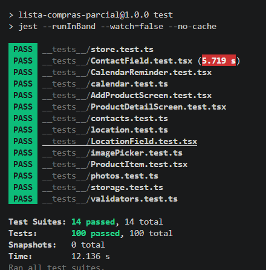

# Mi lista de compras — Parciales 1 y 2 de Aplicaciones Móviles

**Alumno:** Franco Julián Barrera · **Opción elegida:** Lista de compras inteligente.

Continuación de la aplicación del primer parcial, realizada con React Native, Expo SDK 58 y TypeScript. Conserva la lista por usuario y el recordatorio local de diez segundos, e incorpora Zustand, fotos, ubicación del comercio, contactos e integración con calendario. La creación de eventos de calendario está implementada y cubierta por pruebas automatizadas, pero no fue validada con eventos reales en el iPhone.

## Ejecución

Requiere Node.js 22.13 o posterior de la rama 22, 24.3 o posterior de la rama 24, o 26 o posterior, y Expo Go compatible con SDK 58 en un teléfono. Desde la carpeta del proyecto:

```bash
npm install
npm start
```

Con el teléfono y la computadora en la misma red, escanear el QR desde la cámara de iOS o desde Expo Go en Android. Si la conexión de red local no está disponible, ejecutar `npx expo start --tunnel` y aceptar la instalación del paquete del túnel si se solicita. Expo Go puede solicitar una cuenta de Expo.

## Base conservada del primer parcial

- Cuatro pantallas con React Navigation y Native Stack: Login, Registro, Home y Alta de producto.
- Registro local con usuario y contraseña, confirmación de contraseña y control de usuarios duplicados.
- Login que valida las credenciales registradas. Las pantallas privadas solo se montan después de iniciar sesión.
- Cierre de sesión. Al reiniciar la aplicación se solicita un nuevo login; los usuarios y productos permanecen guardados.
- Alta de productos con nombre y cantidad, listado, marcado como comprado y eliminación con confirmación.
- Persistencia con AsyncStorage y listas independientes para cada usuario.
- Notificación local mediante expo-notifications: el botón de Home programa un recordatorio a los 10 segundos y solicita permiso cuando corresponde.
- La modificación de la lista o el cierre de sesión cancela el recordatorio pendiente. Puede volver a programarse desde Home.
- Componentes reutilizables ProductItem y PrimaryButton, componentes básicos de React Native y estilos con StyleSheet.
- Validaciones de formularios y mensajes de error.

La autenticación es exclusivamente didáctica y local: las contraseñas se guardan sin cifrar, como permite la consigna. No utiliza backend ni Firebase. Para comprobar las notificaciones se requiere un dispositivo móvil y permisos habilitados. Las cuatro pantallas originales se conservan; el segundo parcial agrega el detalle del producto.

## Pruebas automatizadas

```bash
npm test
npm run typecheck
npm run lint
```

Jest y React Native Testing Library verifican validaciones, autenticación, persistencia por usuario, acciones del store, controles de lista, alta y detalle, fotos, ubicación, contactos y calendario. Las APIs nativas se prueban con mocks: estos tests no sustituyen la validación de recursos reales del dispositivo. La suite actual tiene 14 suites y 100 tests, por encima de los tres tests mínimos indicados en la consigna.

## Organización

- `App.tsx`: navegación y proveedores de interfaz.
- `src/screens/`: Login, Registro, Home, Alta y Detalle.
- `src/components/`: componentes reutilizables y controles de ubicación, contactos y calendario.
- `src/store/useAppStore.ts`: estado global y acciones de Zustand.
- `src/services/`: almacenamiento local, fotos, permisos y acceso a recursos del dispositivo.
- `src/utils/validators.ts`: reglas de validación.
- `__tests__/`: pruebas automatizadas.

### Evidencia histórica del primer parcial

La siguiente captura corresponde a las 3 suites y 8 tests del primer parcial; no representa el resultado de la suite ampliada del segundo parcial.


### Evidencia actual del segundo parcial

En una ejecución nueva del 17/11/2026, se ejecutó `npm test -- --watch=false --no-cache`: aprobaron las 14 suites y los 100 tests. La salida de esa ejecución se conserva sin recrear sus resultados en [docs/tests-parcial2.txt](docs/tests-parcial2.txt).

La siguiente captura fue tomada por el alumno en PowerShell durante otra ejecución del mismo comando. Muestra las 14 suites y los 100 tests aprobados. La captura y el archivo de texto corresponden a ejecuciones distintas; ambos conservan sus resultados originales. La evidencia histórica del primer parcial permanece separada.



## Videos demo

### Primer parcial

[Video original del primer parcial](https://youtube.com/shorts/_2fgLfN9sKk).

### Segundo parcial

[Video demo del segundo parcial](https://youtube.com/shorts/DAhivtTw1qw).

El video del primer parcial se conserva por separado. La integración de calendario está implementada y tiene pruebas automatizadas, pero no fue validada con eventos reales en el iPhone: en Expo Go se muestra un mensaje informativo.

El fragmento recibido de la consigna se corta después de “Video DEMO actualizado en YouTube (no más”; queda pendiente confirmar el límite de duración y comprobar que el video lo cumpla.

## Novedades del segundo parcial y revisión de requisitos

Revisión basada en la consigna compartida para la lista de compras. Fecha de entrega y exposición indicada: 17/11/2026.

| Requisito | Implementación y evidencia | Estado |
| --- | --- | --- |
| Continuar la app del primer parcial | Mismo repositorio, usuarios y listas conservados; autenticación local y notificación de diez segundos. | Implementado. |
| Permisos antes de usar recursos | Cámara, galería, ubicación y contactos consultan y solicitan permisos al utilizarse; mensajes de espera, denegación y acceso a Ajustes. Calendario implementa su flujo para compilaciones de desarrollo. | Implementado; permisos nativos de calendario sin validar en iPhone. |
| Cámara y galería | expo-image-picker y expo-file-system; foto del producto en alta, miniatura y detalle, reemplazo, eliminación y cancelación. | Pruebas automatizadas y prueba manual de fotos en alta y detalle confirmada por el alumno. |
| Ubicación GPS | expo-location; coordenadas del comercio y alternativa manual, con actualización y eliminación. | Pruebas automatizadas y prueba manual confirmada por el alumno. |
| Contacto del dispositivo | expo-contacts; selector con búsqueda, acceso limitado y alternativa manual. Solo se guardan los datos del contacto elegido. | Pruebas automatizadas y prueba manual confirmada por el alumno. |
| Evento de calendario vinculado | expo-calendar; fecha futura, calendario editable, título, cantidad, comercio y referencia persistida. | Código implementado y probado con mocks. Falta validar un evento real; Expo Go no permite ejecutar esta integración en SDK 58. |
| Estado global | Zustand para sesión y productos; acciones de alta, actualización y eliminación; selectores individuales. | Implementado y cubierto por tests. |
| Testing con Jest | Tests de servicios, componentes y store, incluidos errores de persistencia y permisos. | 14 suites y 100 tests en la suite actual. |
| Documentación y videos | Instrucciones, uso de recursos, limitaciones y apartado de IA. Videos de ambos parciales enlazados por separado. | Enlaces incluidos; límite de duración del segundo video pendiente de confirmar. |

Las confirmaciones manuales anteriores provienen de lo informado por el alumno durante el desarrollo. No implican que se haya verificado manualmente cada combinación de permisos o casos de error en todos los dispositivos.

### Estado global y compatibilidad de datos

El Context original fue reemplazado por `src/store/useAppStore.ts`. Zustand administra usuario autenticado, productos y estado de operación; expone acciones para registrar e iniciar sesión, agregar, marcar y eliminar productos, actualizar foto, ubicación y contacto, y crear el evento de calendario. Las pantallas consumen campos y acciones con selectores individuales.

Los campos y errores de los formularios continúan como estado local. Los cambios de productos se guardan antes de actualizar el estado visible. La sesión no se persiste: al reiniciar se solicita login.

Se conserva el servicio de AsyncStorage y sus claves: `@compras:usuarios` y `@compras:productos:<usuario normalizado>`. Los nuevos campos del producto son opcionales, por lo que los productos anteriores sin foto, ubicación, contacto o evento siguen siendo válidos. No se usa el middleware persist de Zustand ni se agrega una conversión de los datos existentes.

### Fotos del producto

Desde el alta se puede tomar o elegir una foto opcional, ver la vista previa, reemplazarla o quitarla antes de guardar. Desde el detalle de un producto guardado se pueden realizar las mismas acciones. En la lista, tocar el nombre o la miniatura abre el detalle; marcar como comprado y eliminar mantienen controles separados.

Se solicita permiso antes de abrir cámara o galería. Si la cámara se rechaza, se puede usar la galería. Un permiso bloqueado ofrece acceso a Ajustes; cancelar el selector conserva la foto anterior.

La imagen se copia a la carpeta de documentos de la app mediante expo-file-system. AsyncStorage guarda un nombre de archivo relativo en el producto y la URI se reconstruye al mostrarlo. No se depende solo de una imagen temporal de caché. Si el guardado falla, el store conserva los datos anteriores e intenta limpiar la copia nueva. La persistencia local no constituye una copia de seguridad frente a la desinstalación de la app.

## Ubicación del comercio

La ubicación es opcional y se puede asociar desde el alta o el detalle del producto.

- Tocá Usar ubicación actual para solicitar permiso de ubicación en primer plano y obtener las coordenadas GPS.
- También podés escribir un nombre o dirección y tocar Usar comercio manual. Este dato se muestra como ingresado manualmente y reemplaza las coordenadas si existían.
- Desde el detalle podés actualizar o quitar la ubicación. Los productos anteriores sin ubicación siguen funcionando.
- Si el permiso está denegado o la localización no está disponible, podés ingresar el comercio manualmente o reintentar. Si el permiso está bloqueado, el botón de Ajustes permite habilitarlo.
- En Expo Go, los permisos se administran para Expo Go en los ajustes del iPhone. La app no solicita ubicación en segundo plano.

Los datos se conservan por usuario con las mismas claves de AsyncStorage. No se utilizan mapas, servicios externos ni claves API.

## Contacto asociado al producto

El contacto es opcional y se puede asociar desde el alta o el detalle. Tocá Elegir contacto del teléfono para solicitar acceso a los contactos y buscar por nombre, teléfono o email. Con acceso limitado en iOS solo se muestran los contactos autorizados.

Se conserva el nombre y, cuando existen, el primer teléfono y email disponibles. La agenda se usa temporalmente en el selector y no se guarda en AsyncStorage. El contacto elegido queda como una copia de esos datos, sin modificar la agenda del teléfono.

Podés reemplazar o quitar la asociación. Cancelar la selección conserva el contacto anterior. Si se deniega el permiso o no hay contactos, completá el nombre manualmente y, si querés, teléfono o email, y tocá Usar contacto manual. Si el permiso está bloqueado, se ofrece acceso a Ajustes. En Expo Go, los permisos se administran para Expo Go en los ajustes del iPhone.

## Evento de compra en el calendario

La integración con expo-calendar está implementada y tiene pruebas automatizadas de permisos, selección de calendario, validación de fecha y hora, creación del evento, persistencia y prevención de duplicados. Las pruebas utilizan mocks de las APIs nativas; no verifican la creación de eventos reales en el dispositivo.

**Estado para la entrega: no se validó manualmente la creación de eventos reales en el iPhone.** En SDK 58, expo-calendar requiere una compilación de desarrollo y no está disponible en Expo Go. Al intentar usar la función en Expo Go, la app muestra un mensaje informativo y conserva el resto de sus funcionalidades. No se preparó una compilación de desarrollo para esta entrega.

La implementación utiliza la API real del calendario del dispositivo. El siguiente flujo requiere una compilación de desarrollo:

Desde el detalle de un producto guardado, tocá Crear evento de compra. Al utilizar la función se solicita acceso al calendario para listar los calendarios editables. No se solicitan permisos para la app Recordatorios de iOS.

Elegí un calendario y escribí una fecha futura en formato DD/MM/AAAA y una hora en formato HH:MM de 24 horas, usando la hora local del teléfono. Confirmar evento de compra crea un evento real de 30 minutos con título Comprar: seguido del nombre del producto, cantidad, comercio si existe y una alerta al inicio. Cancelar antes de confirmar conserva el producto.

El detalle muestra el calendario, la fecha de compra y cuándo se creó la asociación. Un producto con evento asociado no permite crear otro. La asociación se guarda por usuario con las claves existentes de AsyncStorage. El recordatorio local de diez segundos sigue disponible en la lista y es independiente del evento.

Si no hay calendarios editables, agregá o habilitá uno desde la app Calendario del teléfono y reintentá. Si el permiso está bloqueado, la app ofrece acceso a Ajustes.

### Requisito para validar eventos reales

La validación manual de eventos reales queda pendiente hasta disponer de una compilación de desarrollo instalada en el iPhone con expo-calendar. Consultá la [documentación oficial de expo-calendar](https://docs.expo.dev/versions/v58.0.0/sdk/calendar/) y la [guía de compilaciones de desarrollo](https://docs.expo.dev/develop/development-builds/introduction/).

No se agregan servicios externos ni claves API. Los eventos creados mediante la API permanecen en Calendario aunque después se elimine el producto; esta etapa no sincroniza cambios realizados fuera de la app.

## Estilo y verificación

Las convenciones de desarrollo están en AGENTS.md. Para aplicar el formato a la aplicación, tests y configuración escrita a mano, y comprobarlo:

```bash
npm run format
npm run lint
npm test
npm run typecheck
```

Prettier ordena la indentación y JSX; ESLint exige llaves, cuerpos de función en bloque, retornos explícitos en funciones flecha, declaraciones separadas y una instrucción por línea. El comando de formato termina con ESLint para conservar las llaves multilínea también en bloques vacíos. Se excluyen dependencias, archivos generados y package-lock.json del formateo.

## Punto extra: IA aplicada al desarrollo

### Herramienta y alcance real

Se utilizó Codex como asistente de desarrollo sobre este repositorio para inspeccionar el proyecto, proponer e implementar la migración a Zustand, generar código y tests de las integraciones nativas, revisar errores, aplicar el refactor de legibilidad y actualizar la documentación.

El alumno definió requisitos y restricciones, pidió ajustes, realizó las pruebas manuales de fotos, ubicación y contactos e indicó cuándo aprobar cada commit. Codex ejecutó los comandos de verificación y creó los commits locales autorizados. No se utilizaron Figma, conversores de diseño a código ni plugins de generación de interfaces; este punto extra corresponde a asistencia en código, refactor y documentación de prompts.

### Ejemplos reales de prompts

Estos son extractos textuales de los mensajes usados en esta conversación; se omiten otras partes del mismo mensaje para mantenerlos breves.

**Contexto y diagnóstico antes de cambiar código:**

> Este repositorio contiene mi primer parcial de Aplicaciones Móviles: una lista de compras con React Native, Expo y TypeScript.
>
> No modifiques código todavía.

El pedido inicial también solicitó inspeccionar el proyecto, ejecutar tests y TypeScript, explicar el estado, la autenticación y la persistencia, y proponer la migración antes de implementarla.

**Migración con restricciones de compatibilidad:**

> Implementá la migración a Zustand propuesta.
>
> Conservá las claves y formatos de AsyncStorage, el comportamiento de la autenticación, el guardado antes de actualizar la interfaz y el manejo de recordatorios.
>
> Usá selectores individuales para consumir el store y eliminá el Context y su proveedor cuando ya no se utilicen.

**Refactor con convenciones explícitas:**

> En funciones flecha, usar llaves y return explícito cuando devuelvan un valor; evitar retornos implícitos.
>
> No alcanza con ejecutar Prettier: revisá también las funciones de una sola línea, los retornos implícitos y los bloques sin llaves.

**Límite de validación y documentación de calendario:**

> Vamos a conservar calendario con su limitación actual, sin preparar una compilación de desarrollo.
>
> No presentes calendario como una funcionalidad validada manualmente ni reemplaces su implementación por una simulación.

Los prompts aportaron contexto del proyecto, requisitos concretos, restricciones de persistencia y estilo, verificaciones esperadas y límites de alcance. El trabajo se realizó por etapas y con correcciones solicitadas por el alumno; no se atribuyen resultados a Figma, a una compilación de desarrollo ni a pruebas de calendario real que no se hicieron.

### Propuesta o código inicial frente a la versión integrada

| Versión inicial o propuesta generada | Ajuste solicitado o problema observado | Resultado integrado |
| --- | --- | --- |
| Migrar Context a un store con los mismos datos y acciones. | Conservar las claves y formatos de AsyncStorage, los recordatorios y el guardado antes de actualizar la interfaz. | Store Zustand con selectores individuales, servicio de almacenamiento existente y tests de compatibilidad, aislamiento y errores. Los formularios conservan estado local. |
| Fotos disponibles inicialmente desde el detalle de un producto ya creado. | El alumno señaló que quería poder agregar la foto durante el alta. | Foto opcional también en Nuevo producto; producto e imagen se guardan juntos y el formulario permite reintentar si falla el guardado. |
| Proyecto basado en Expo SDK 57. | Expo Go del iPhone requería SDK 58 y se encontró un conflicto del preset de Jest. | SDK 58 con React, React Native y testing alineados. El alumno confirmó que la app volvió a abrir en Expo Go. |
| Código generado con selectores de retorno implícito y algunos bloques compactos. | Reglas de legibilidad: llaves, return explícito, una instrucción por línea y ausencia de comentarios explicativos. | Refactor de aplicación y tests, Prettier, ESLint y AGENTS.md, sin cambios de funcionalidad en esa etapa. |
| Integración de calendario mediante la API nativa de expo-calendar. | La documentación de SDK 58 y el mensaje visto en el iPhone indicaron que no estaba disponible en Expo Go. | Se conservó la implementación real y los tests con mocks. Se documentó la necesidad de una compilación de desarrollo y la falta de validación de eventos reales. |

## Pendientes para completar la entrega

- Confirmar el límite de duración del video, que no aparece completo en el texto recibido, y comprobar que el video del segundo parcial lo cumpla.
- La creación de eventos reales de calendario queda sin validar en el iPhone. Documentar la limitación no equivale a cumplir la validación funcional de ese recurso; su aceptación depende del docente.
- Publicar los commits y el README final en el mismo repositorio, cuando el alumno lo autorice. La rama de trabajo es `feat/segundo-parcial`; verificar que el enlace entregado abra la versión del segundo parcial y no únicamente el contenido anterior de `main`.
- Repositorio: [FrancoJulianB/parcial1-aplicaciones-moviles](https://github.com/FrancoJulianB/parcial1-aplicaciones-moviles). Se comprobó que es público durante esta revisión; conservar esa visibilidad para la entrega.
- Compartir nuevamente el enlace actualizado según la consigna, con `martin.cornejo@istea.com.ar`. Este paso no se realizó desde Codex.
